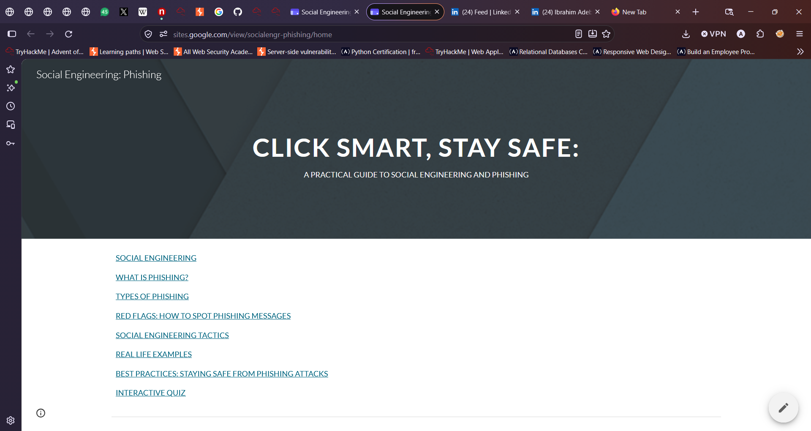
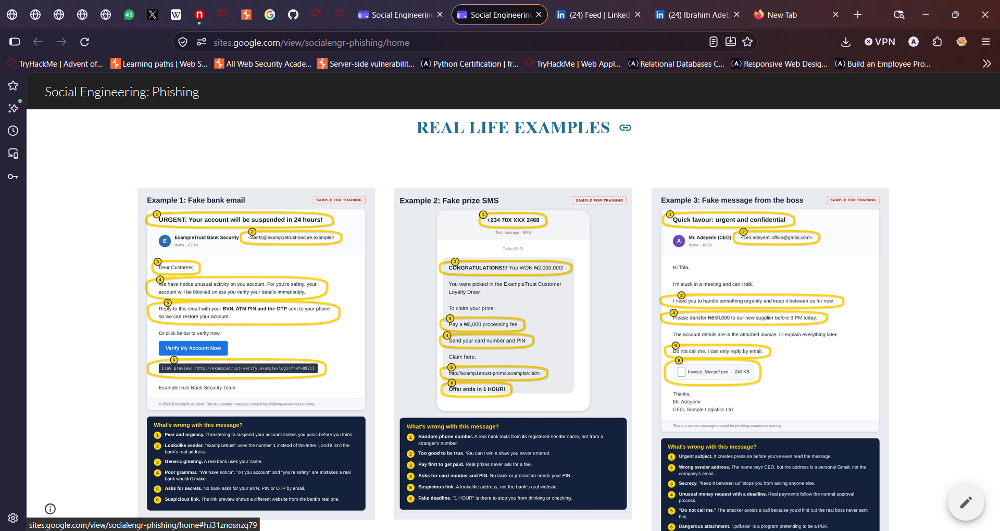
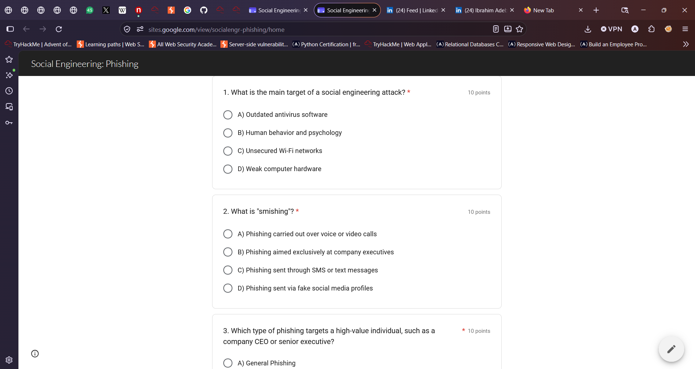

# Phishing Online Module

**CodeAlpha Cyber Security Internship, Task 2.**

## 📌 Project Overview

An online module that teaches about social engineering, phishing, how to recongnize or spot phishing emails, type of phishing, social engineering tactics and best practices or tips to avoid phishing.

## 🎯Objectives

- Create a presentation or online module focused on phishing attacks. 
- Explain how to recognize phishing emails and fake websites. 
- Educate about social engineering tactics used by attackers. 
- Provide best practices and tips to avoid falling victim. 
- Include real-world examples and interactive quizzes for better engagement.

## Module link
<https://sites.google.com/view/socialengr-phishing/home>

**The module teaches social engineering and phishing awareness,  contains real-life examples  and interactive quizzes **

# 👤 Author

**ADEBAYO IBRAHIM**\
Cybersecurity Professional

LinkedIn: [www.linkedin.com/in/ibrahim-adebayo-118613449](www.linkedin.com/in/ibrahim-adebayo-118613449/)

---

## 📌 Project Information

**Program Name:** Cybersecurity at CodeAlpha | **Task 02** Phishing Online Module| **Repository:** GitHub
